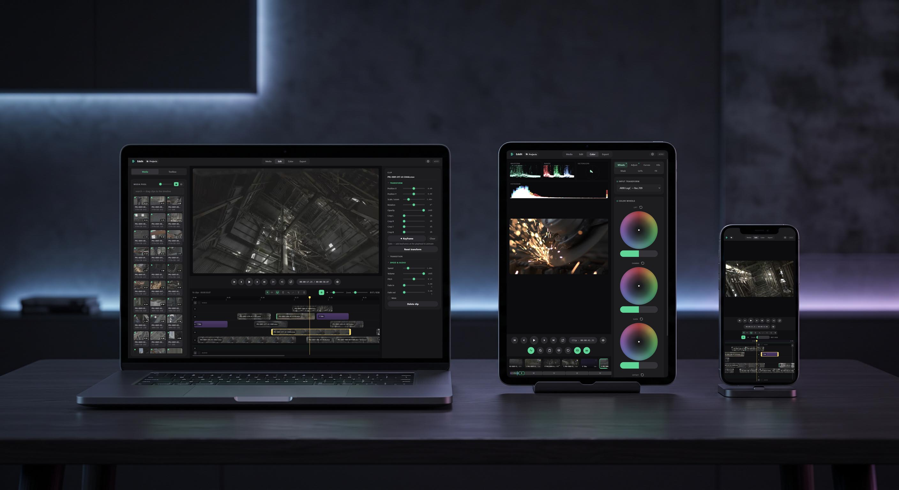

  

# Eddit

**Cut, grade and export video — entirely in your browser.**

## Features

- **Edit** — multi-track timeline with razor, trim, snapping, cross-dissolves, gaps, markers, undo/redo, In/Out section with draggable flags and loop playback
- **Titles** — 7 font styles, weight control, per-letter animations (fade / rise / pop) with dual-handle in/hold/out timing, drop shadow and outline
- **Color** — lift/gamma/gain/offset wheels, spline curves (RGB + per-channel), HSL curves (hue·hue / hue·sat / hue·lum), tone mapping (shadow/highlight zone gains + ACES filmic), LUTs (`.cube`, conversion + creative), input transforms for C-Log2/3, S-Log3 and LogC
- **Secondary grading** — colour qualifier with eyedropper, power windows (circle / rect / linear) with feather and invert, matte preview
- **Scopes** — waveform, RGB parade, vectorscope, histogram
- **FX** — glow (exponential bloom), vignette, turbulence displace, wiggle — per clip, plus keyframeable transforms, speed ramps and pitch-preserving audio
- **Media** — import nearly any codec: H.264, 10-bit H.265, ProRes and more decode through a tiered WebCodecs → ffmpeg pipeline, with automatic editing proxies and filmstrip hover-scrub
- **Export** — full-quality renders straight from your originals: GPU-graded H.264 MP4 with AAC audio up to 4K, any source codec
- **Every device** — a carefully considered, fully adaptive interface with purpose-built layouts for desktop, tablet and phone; installs as a PWA and projects autosave locally
- **Private by design** — no server, no upload, no account; your footage never leaves your machine

Requires a browser with WebGPU (Chrome/Edge 113+).

> [!NOTE]
> Eddit is early and moving fast — a lot more is on the way. Feedback is very welcome: [open an issue](https://github.com/krth8/Eddit/issues) with bugs, ideas or footage that misbehaves.

Licensed under the [Elastic License 2.0](LICENSE) — free to use and self-host; may not be offered as a hosted service. Bundled third-party components (ffmpeg.wasm core, mp4box.js, mp4-muxer, coi-serviceworker) keep their own licenses.
